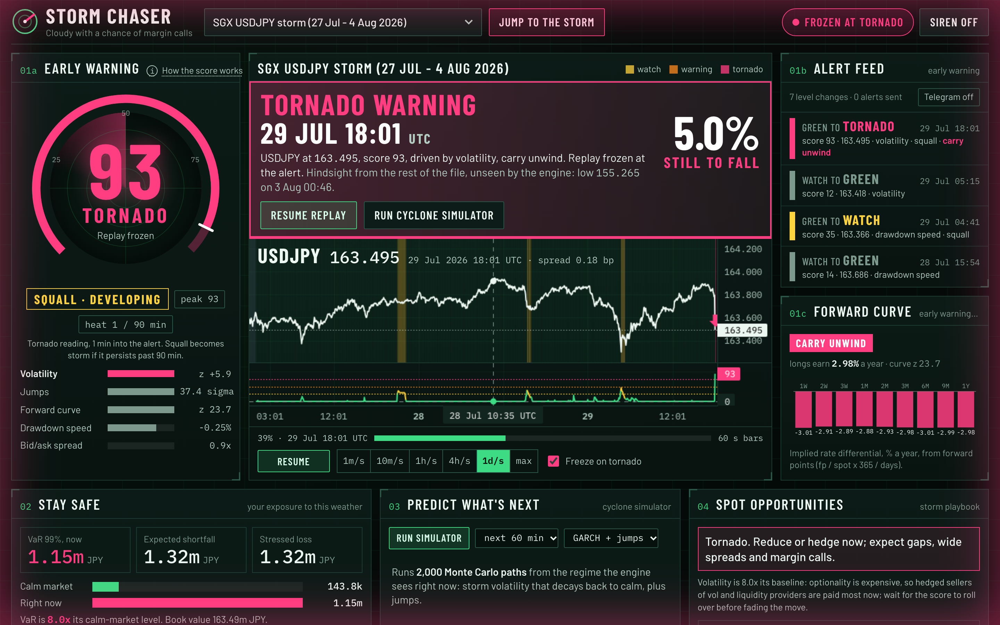

# Storm Chaser — "Cloudy with a chance of margin calls"

Storm score (0-100, green / watch / warning / tornado) for any price feed, plus exposure, a Monte Carlo "cyclone simulator" and a storm playbook, on a weather-radar dashboard. DurHack 2026, SGX FX challenge.

**Live demo (no install): https://noaholland.github.io/storm-chaser/** Press **Jump to the storm**.



Solo entry for DurHack 2026 (SGX FX challenge, "Protect your assets from a trading market storm"). Python engine and API (FastAPI, numpy, pandas), React + TypeScript dashboard. 150 backend tests, a 47-check end-to-end script over three real crises, 10 browser tests. Write-up: [assets/devpost.md](assets/devpost.md). 33-second clip: [assets/demo-short.mp4](assets/demo-short.mp4).

## The live demo is a static site

The page above is `docs/`, served by GitHub Pages with no backend. What runs where:

| Part | In the static demo |
|---|---|
| Storm score, levels, drivers, carry curve, alerts, playbook, chart history, the tornado freeze and its hindsight number | Recorded from the Python engine, tick by tick, into `docs/data/*.json` by `scripts/build_static.py`, and played back in the browser. Nothing is re-scored in JavaScript. Three replays: SGX USDJPY storm, FTX 2022, GBP mini-budget 2022 |
| Exposure (VaR / ES / stressed loss) and the hedge what-if | Ported to TypeScript (`web/src/static/risk.ts`), fed by the recorded regime. Deterministic, checked against Python |
| Cyclone simulator | Ported to TypeScript: same GARCH + jumps / bootstrap model and calibration, the browser's own random numbers |
| Live Binance, yfinance, Telegram alerts, the full two-month SGX sets | Disabled, with a note in the picker and the footer. Run locally for live feeds (below) |

`make parity` proves the first two rows: the Python stack writes reference output (the snapshot after every tick, plus the real FastAPI responses frozen at the first tornado and at the end of each replay), then the code the site ships answers the same questions from `docs/data/`. Latest run: 2,300,094 values compared, 0 differences. Snapshots, history, alerts and the hindsight callout are compared as identical doubles; exposure to 1e-12 relative (the last bits of `expm1` differ between runtimes); the simulator, being random, by distribution (5 / 50 / 95 percentiles, tail average, P(loss) within tolerance of a 20,000-path Python run).

`make site` rebuilds `docs/`; `make e2e-static` drives it in a headless browser under a `/storm-chaser/` sub-path, including a 390 px phone.

## Run it locally (live feeds, full API)

**One command** (Python 3.11+, [uv](https://docs.astral.sh/uv/), Node 20+):

```
make install     # once: Python deps
make app         # builds the dashboard, starts API + UI on http://localhost:8000/
```

Then press **Jump to the storm**: the SGX USDJPY replay runs to the first tornado (29 Jul 2026 18:01 UTC) and freezes there. `PORT=9000 make app` picks another port. A browser at `/` lands on the dashboard (`/ui/`); scripts get JSON; API docs are at `/docs`.

**Other targets:** `make test` (150 backend tests) · `make e2e` (8 browser tests, start their own stack) · `make demo` (end-to-end on the SGX USDJPY storm, FTX and the GBP mini-budget; exits 0) · `make serve` (API only) · `make live-check` (Binance + yfinance, needs internet). Frontend dev loop: `make serve`, then `cd web && VITE_API=http://localhost:8000 npm run dev`.

## Dashboard (`web/`, React + Vite + TypeScript, lightweight-charts)

The four pillars of the brief are the four numbered sections of the screen.

| Section | What it shows |
|---|---|
| 01 Early warning | Storm gauge 0-100 on a radar scope, level colour, squall / storm label, the five driver components as bars, alert feed (every level change, Telegram status), forward curve with the carry-unwind flag (SGX sets) |
| Storm track | Price with level-coloured background bands and alert markers, score pane underneath, replay transport: play / pause, six speeds, freeze on tornado, progress |
| 02 Stay safe | Add / remove positions (kept in the browser), VaR / ES / stressed loss per currency, calm market against right now |
| 03 Predict what's next | Cyclone simulator: 5 / 50 / 95 fan, P(loss), GARCH + jumps or bootstrap, 15 bars to a day |
| 04 Spot opportunities | Storm playbook: a hedge idea and a long-volatility idea for the current level, each labelled illustrative, plus a hedge what-if slider re-priced through `/exposure`. Not advice |

Header: feed picker (SGX USDJPY / EURUSD / USDSGD 2026, FTX 2022, GBP 2022, live BTC / ETH, yfinance presets), feed-health pill, storm siren (Web Audio, off until switched on, louder and faster with the score).

**The freeze frame.** With *Freeze on tornado* ticked the replay stops itself the moment the level reaches tornado and shows the alert time, price, drivers and, from the rest of the replay file, how far the price still had to fall (USDJPY: 5.0%, low 155.26 on 3 Aug). That number is hindsight, labelled as such: the engine never sees ahead.

**Edge states in the UI** (each covered by a browser test in `web/e2e/`): API down (banner, countdown, *Retry now*, old readings dimmed, no score shown) · SSE stream dropped (says so, reconnects) · warming up (no number, "12 of 60 bars") · stale feed (score withheld, never green) · no feed · feed refused (toast with the server's reason) · empty portfolio · unknown asset (flagged on its row, left out of totals) · bad position input · simulator before warm-up · replay finished · fan chart older than the market (flagged) · maximum replay speed · 1280 px laptop.

Screenshots (written by `make e2e`): [calm](assets/screenshots/01-calm.png) · [tornado freeze](assets/screenshots/02-tornado-freeze.png) · [exposure + fan](assets/screenshots/03-exposure-and-fan.png) · [API down](assets/screenshots/04-api-down.png) · [1280x720](assets/screenshots/05-tornado-1280x720.png) · [replay finished](assets/screenshots/06-replay-finished.png) · [warming up](assets/screenshots/07-warming-up.png) · [stale feed](assets/screenshots/08-stale-feed.png) · [static demo on a phone](assets/screenshots/static-03-phone-390.png).

## API

Real response samples are in `assets/samples/`. Telegram alerts: set `TELEGRAM_BOT_TOKEN` and `TELEGRAM_CHAT_ID` before `make app`; unset = silent no-op (the dashboard shows which).

| Endpoint | What it does |
|---|---|
| `GET /health`, `GET /datasets` | liveness + per-feed state (`degraded` if a feed is stale); bundled datasets, yfinance presets |
| `POST /replay?dataset=&speed=&pause_on=tornado` | replay a bundled crisis (`speed` = data-seconds per second, 0.1 to 1e6 or `max`); `pause_on` freezes at that level until `POST /resume` |
| `POST /pause`, `POST /resume`, `POST /speed?speed=` | hold / continue a replay, change its pace mid-flight. While paused, `session.ahead` reports the low and high still to come in the file (hindsight for the demo) |
| `POST /live?symbol=BTCUSDT` | Binance public websocket (bid/ask), auto-reconnect, stale detection |
| `POST /yfinance?symbol=Gold&period=5d&interval=5m` | equities / commodities / FX fallback |
| `GET /score?symbol=` | score, level, components, `kind` (calm / squall / storm), carry curve, feed health, playbook (posture + illustrative trade ideas) |
| `GET /stream?symbol=` | SSE: snapshot + `new_transitions` every 250 ms, heartbeat every 2 s, final `event: end` |
| `GET /history?symbol=&n=` | downsampled price / score / level series + level changes, for charts |
| `POST /exposure` | `{positions:[{asset,size,currency?,entry_price?}],horizon_bars,confidence}` -> P&L, VaR, ES, stressed loss per position and per currency |
| `POST /simulate` | `{symbol,size,steps,n_paths,method:"garch"\|"bootstrap"}` -> 5/50/95 price and P&L fan |
| `GET /alerts`, `POST /stop` | alert log (debounced); stop a feed |

**Architecture** (`stormchaser/`): `adapters/` (binance, replay, sgx, yf) all yield `Tick(ts, price, bid?, ask?, extra?)` -> `score.py` `StormEngine` -> `session.py` (one feed + engine per symbol) -> `api.py` (FastAPI). `exposure.py`, `simulate.py` read the engine's current regime; `alerts.py` is fed by level changes.

**Score.** Components in [0,1]: vol (z-score of log fast-vol vs an exponentially weighted baseline), jump (returns beyond 6 baseline sigmas, decaying), drawdown speed (60-bar drawdown in baseline-sigma units), spread (vs rolling and same-hour-of-day baseline), curve (forward-curve dislocation). `score = 100 * (0.5 * weighted mean + 0.5 * max)`; spread and curve alone can only reach *watch*. Upgrades are immediate; downgrades need 8 points of margin for 5 bars. The baseline keeps learning (half-life 720 bars), so a new permanent regime stops alerting. An alert is a *squall* until alert time accumulates past 90 min (6 h half-life), then a *storm*.

**SGX data.** The raw SGX challenge files are not redistributed here: only the scored nine-day USDJPY storm window that the demo plays back (`docs/data/sgx_usdjpy_storm.json`). To run the SGX feeds and their 8 tests locally, put the challenge's `Challenge1.zip` in `data/sgx/` and run `python scripts/build_sgx.py`; without it those tests skip. `adapters/sgx.py` reads `Challenge1.zip` (zip of zips of daily CSVs) directly; `scripts/build_sgx.py` turns it into the bundled parquet files. Forward points -> annualised implied rate differential per tenor (`fp / spot * 365 / days`); *carry unwind* = the side earning carry is in a fast drawdown while the curve dislocates.

**Edge cases handled** (each has a test): websocket drop / silent socket -> backoff reconnect; no ticks -> `stale` (never green); NaN / zero / negative prices, crossed quotes; duplicate and out-of-order timestamps; weekend gaps (returns scaled by sqrt(time), reopen spreads masked); too little history -> `warming_up` (score `null`); fat-finger tick held until the next tick confirms or rejects it; empty / zero / unknown positions; extreme Monte Carlo and replay-speed parameters clamped and reported.

**Data sources.** BTC: Binance public klines (1m). GBPUSD Sep 2022: HF `Yllvar/fx-historical-data` 15m (Dukascopy tick feed timed out, so no bid/ask on that set). SGX: official challenge file. Thresholds were chosen on these three datasets; treat the score as a heuristic, not advice.

## Licence

Code: MIT, see [LICENSE](LICENSE). The bundled market data stays with its sources (Binance public klines, the `Yllvar/fx-historical-data` set, and the SGX storm window used by the demo) and is included only to make the replays reproducible. Nothing here is investment advice.
